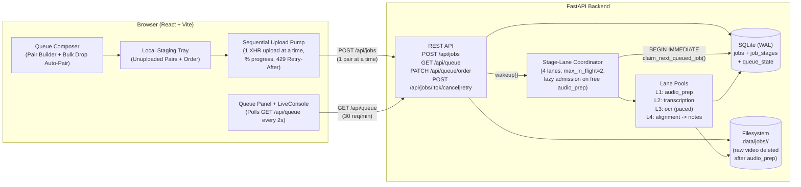
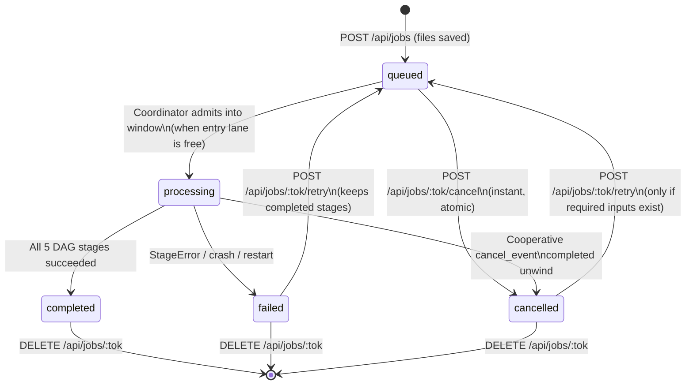

# slidenoteLM — Multi-Lecture Pipelined Queue System Design

**Status:** Locked design ready for implementation (no application code modified yet).  
**Scope:** Allow adding multiple `(recording, slides PDF)` lecture pairs and executing them in **ordered, stage-pipelined sequence** on the backend — as soon as Lecture 1 finishes `ffmpeg` (`audio_prep`), Lecture 2 immediately begins `audio_prep`, and the same handoff applies to `transcription`, `ocr`, and `alignment`/`notes` with bounded lookahead and provider rate-limit awareness.

---

## 1. Locked Product Decisions & Guardrails

### Confirmed Decisions
1. **Auto-pause on systemic auth/config errors (`QUEUE_AUTO_PAUSE_ON_AUTH_ERROR=true`):** Missing/invalid `GEMINI_API_KEY` or `GROQ_API_KEY` (or missing `ffmpeg`/`ffprobe`) automatically pauses the queue with an explicit `pause_reason`, preventing queued lectures from burning quota or failing one-by-one. Per-lecture errors (corrupt media, safety filter, exhausted retries) still fail **only** that lecture and advance the queue.
2. **Do not store raw recordings after normalization (`CLEANUP_RAW_RECORDING_AFTER_AUDIO_PREP=true` by default):** As soon as `audio_prep` verifies `artifacts/audio_normalized.mp3` (~15 MB/hour at 32 kbps) is non-empty on disk, immediately unlink `input/recording.<ext>` (both locally and on Railway). Checkpointed retries for `transcription`, `ocr`, `alignment`, and `notes` continue to work without the raw video.
3. **Server restart behavior:** Keep the existing contract — any job that was `processing` when the server died is marked `failed` with its completed stage checkpoints preserved for 1-click **Retry**, while all `queued` jobs remain `queued` in exact `queue_position` order and resume automatically on startup (unless the queue was paused).
4. **Individual `.md` downloads first; defer `.zip` bundle:** Phase Q1/Q2 ships per-lecture `.md` downloads (in `QueuePanel`, `LiveConsole`, and `HistoryList`). Batch `.zip` bundling (`POST /api/jobs/download-zip`) is deferred to Phase Q3.
5. **Cross-job stage pipelining (assembly-line execution):** Overlap **different** stages across adjacent lectures (`J1` in `transcription`/`notes` while `J2` runs `audio_prep`/`transcription`/`ocr`), bounded to `QUEUE_MAX_IN_FLIGHT_JOBS = 2` (1 active head + 1 pre-warming lookahead) with strict queue-order priority and Gemini rate-limit coordination.

### Non-Goals (Consistent with [PLAN.md](./PLAN.md))
- No external broker/database (no Redis, Celery, RQ, or Postgres) — stays **SQLite + local filesystem**.
- No multi-user accounts or per-user queue isolation (single-owner local tool or single shared `APP_PASSWORD` on Railway).
- No change to NotebookLM `.md` output format, provider selection (Groq Whisper + Google Gemini), or strict Gemini-only OCR policy.

---

## 2. Coordination with Concurrent Codebase Changes

> **Note:** At design time, another active effort in this repository has uncommitted changes across `backend/app/db.py`, `backend/app/worker.py`, `backend/app/config.py`, `backend/app/pipeline/{audio,ocr,prompts}.py`, `PLAN.md`, `README.md`, `.env.example`, and backend tests. This design layers cleanly on top once those changes land.

| Live Change Already in Working Tree | How the Pipelined Queue Builds on It |
| --- | --- |
| **Intra-job DAG in `worker.py`** (`audio_prep \|\| ocr -> transcription -> alignment -> notes`, plus parallel OCR batches and 9-worker notes drafting) | Preserved 100%: `audio_prep` and `ocr` live in separate resource lanes so a single job `J1` still runs `audio_prep` and `ocr` in parallel, while the 4-lane coordinator extends that same DAG model cleanly across `J1` and `J2`. |
| **Checkpoint-aware `run_job()`** (`completed = {s["stage"] ... if status == "completed"}`) | Enables **checkpointed Retry** (`POST /api/jobs/{token}/retry`) almost for free: reset only failed/pending stages and re-enqueue so already-saved `audio_normalized.mp3`, `transcript.json`, or `slides_ocr.json` are reused without re-paying API costs (even after `input/recording.<ext>` is deleted). |
| **`JobStore.queued_job_tokens()` + startup recovery** | Currently orders by `created_at` (1-second resolution via `timespec="seconds"`, non-deterministic on same-second inserts) and eagerly submits all queued jobs to `ThreadPoolExecutor`. Replaced by deterministic `queue_position ASC, rowid ASC` and a DB-backed stage-lane scheduler. |
| **Snapshot read in `JobStore.get_job()`** (`BEGIN` transaction) | Preserved as-is; `get_queue_snapshot()` uses the same single-transaction read pattern so active/queued/recent counts and stage rows stay consistent. |
| **`cancel_event` in `gemini_client.py`** | Already supports cooperative cancellation mid-retry/backoff; wired directly into `JobContext.cancel_event`. |
| **Zero overlap with `prompts.py`, OCR extraction prompts, `notes.py` content rules** | Queue implementation touches only orchestration/API (`db.py`, `worker.py`, `schemas.py`, `main.py`, `ratelimit.py`, `config.py`, lightweight cancel checks in `ocr.py`/`transcribe.py`) and `frontend/src/`. |

**Recommended merge strategy:** Let the current in-progress commit on `main` land (or implement the queue on a separate git worktree/branch once `db.py` and `worker.py` are committed) to avoid line-level conflicts in `db.py`, `worker.py`, and `test_phase1_api.py`.

---

## 3. High-Level Architecture & Stage Pipelining

### 3.1 Why Stage Pipelining Fits `slidenoteLM` Perfectly

The 5 background stages map onto **4 distinct resource lanes**:

| Lane | Stage(s) | Underlying Resource / Quota | Why 1 Job per Lane Is Optimal |
| --- | --- | --- | --- |
| **Lane 1: `audio_prep`** | `audio_prep` | Local CPU + disk I/O (`ffmpeg` / `ffprobe`) — **0 external API calls** | Running 1 `ffmpeg` normalization at a time avoids disk/CPU thrashing and immediately deletes `input/recording.<ext>` on completion, freeing space before the next lecture starts. |
| **Lane 2: `transcription`** | `transcription` | **Groq Whisper API** (`20 RPM`, up to 4 chunk workers) — **independent vendor** | 1 lecture's chunk workers already saturate Groq cleanly; zero overlap with Gemini or `ffmpeg`. |
| **Lane 3: `ocr`** | `ocr` | **Google Gemini OCR** (`gemini-4-neon`, `LOW` thinking, `20 RPM` local bucket, up to 8 batch workers) | Independent of `ffmpeg` and Groq; **shares the Google Gemini API key** with Lane 4 (see Section 5.3 for pacing). |
| **Lane 4: `llm`** | `alignment` → `notes` | **Google Gemini LLM** (`gemini-4-neon`, `HIGH` thinking, `30 RPM` local bucket, 9 drafting workers) | Heavy Gemini consumer; keeping 1 lecture at a time in `alignment` → `notes` gets Lecture 1's `.md` finished as fast as possible. |

### 3.2 Assembly-Line Timeline (`J1`, `J2`, `J3`)

```text
Time ────────────────────────────────────────────────────────────────────────►

Lane 1 (ffmpeg)      : [  J1 audio  ][  J2 audio  ]               [  J3 audio  ]
Lane 2 (Groq 20 RPM) :               [ J1 transcr ][ J2 transcr ]               [ J3 transcr ]
Lane 3 (Gemini OCR)  : [   J1 ocr   ][   J2 ocr (paced)  ]        [   J3 ocr (paced)  ]
Lane 4 (Gemini LLM)  :                             [ J1 align+notes ][ J2 align+notes ][ J3 align+notes ]
                                                                     ▲                 ▲
                                                              J1 .md ready!     J2 .md ready!
                                                              J3 admitted here!
```

Compare against strict 1-job-at-a-time:
- While `J1` spends 2–4 minutes in `alignment` + `notes`, **`J2` finishes `audio_prep`, `transcription`, AND `ocr` in the background** using lanes that would otherwise sit 100% idle.
- The instant `J1` completes `notes`, **`J2` enters `alignment` with zero preparation wait**, and `J3` enters `audio_prep`!
- **`J1` is NEVER slowed down** because every lane grants strict priority to the lowest `queue_position`.

### 3.3 End-to-End System Flow



---

## 4. Data Model & SQLite Schema (`SCHEMA_VERSION = 3`)

### 4.1 Schema Changes (`backend/app/db.py`)
Additive, idempotent migration from `SCHEMA_VERSION = 2` → `3` inside `_migrate_schema(conn)`:

```sql
-- New columns on existing `jobs` table (added via ALTER TABLE if missing)
ALTER TABLE jobs ADD COLUMN queue_position INTEGER;
ALTER TABLE jobs ADD COLUMN batch_id TEXT;
ALTER TABLE jobs ADD COLUMN queue_label TEXT;

-- Backfill existing rows deterministically by rowid
UPDATE jobs
SET queue_position = rowid * 1000
WHERE queue_position IS NULL;

-- Singleton table persisting pause state across restarts
CREATE TABLE IF NOT EXISTS queue_state (
    id INTEGER PRIMARY KEY CHECK (id = 1),
    paused INTEGER NOT NULL DEFAULT 0,
    pause_reason TEXT,
    updated_at TEXT NOT NULL
);

INSERT OR IGNORE INTO queue_state (id, paused, pause_reason, updated_at)
VALUES (1, 0, NULL, CURRENT_TIMESTAMP);

-- Indexes for O(log N) claiming and listing
CREATE INDEX IF NOT EXISTS idx_jobs_queue_order
    ON jobs(status, queue_position ASC, rowid ASC);
CREATE INDEX IF NOT EXISTS idx_jobs_created_at
    ON jobs(created_at DESC, rowid DESC);
CREATE INDEX IF NOT EXISTS idx_jobs_batch_id
    ON jobs(batch_id);
```

**Design details:**
- **`queue_position` spacing & concurrency:** `create_job()` runs inside `BEGIN IMMEDIATE` and assigns `COALESCE(MAX(queue_position), 0) + 1000`, guaranteeing strictly monotonic, unique positions even under concurrent uploads. `PATCH /api/queue/order` rewrites dense values `(idx + 1) * 1000` for reordered `queued` rows inside a single `BEGIN IMMEDIATE` transaction. Tie-breaking always uses `ORDER BY queue_position ASC, rowid ASC`.
- **`batch_id` (optional):** Client-generated opaque ID (e.g. `batch_<uuid>`) attached when uploading a multi-pair set for batch progress summaries (`3 of 6 complete`) and future Phase Q3 `.zip` downloads.
- **`queue_label` (optional):** User-editable display title (defaults to `slides_filename` in UI if null).
- **`queue_state.paused` & `pause_reason`:** Persisted so restarting the server while paused never unexpectedly burns API quota.

### 4.2 Job & Stage State Machine

Expand `JobStatus` and `StageStatus` in `backend/app/schemas.py`:
```python
JobStatus = Literal["queued", "processing", "completed", "failed", "cancelled"]
StageStatus = Literal["pending", "running", "completed", "failed", "cancelled"]
```



### 4.3 Atomic Queue Operations in `JobStore`

| Method | Concurrency & Atomicity Guarantee |
| --- | --- |
| `claim_next_queued_job() -> str \| None` | Runs inside `BEGIN IMMEDIATE`: checks `queue_state.paused == 0`; selects `token FROM jobs WHERE status = 'queued' ORDER BY queue_position ASC, rowid ASC LIMIT 1`; updates `SET status = 'processing', started_at = COALESCE(started_at, ?), updated_at = ? WHERE token = ? AND status = 'queued'`. Returns `token` or `None`. |
| `reorder_queued_jobs(ordered_tokens: list[str]) -> list[str]` | Runs inside `BEGIN IMMEDIATE`: fetches all currently `queued` tokens in current order; places valid tokens from `ordered_tokens` first (in requested order) followed by any remaining `queued` tokens not in the request (prevents accidental drops if a new job was enqueued concurrently), then updates `queue_position = (i + 1) * 1000`. Tokens that already transitioned to `processing` are silently ignored (no 500/race error). |
| `cancel_queued_job(token: str) -> bool` | Atomic `UPDATE jobs SET status = 'cancelled', updated_at = ?, completed_at = ? WHERE token = ? AND status = 'queued'`. Returns `True` iff `rowcount == 1`. If `False`, caller triggers cooperative cancellation on the active job. |
| `mark_job_cancelled(token: str)` | Marks `status = 'cancelled'` (`WHERE token = ? AND status IN ('queued', 'processing')`) and marks any `running` stage as `cancelled` with `"Cancelled by user."`. |
| `mark_job_started(token: str)` | Guarded with `WHERE token = ? AND status IN ('queued', 'processing')` so an already-cancelled job can never be resurrected between claim and stage entry. |
| `retry_job(token: str, *, from_scratch: bool = False, position: Literal["end", "front"] = "end") -> dict` | Validates `status IN ('failed', 'cancelled')`. If `from_scratch=False`, preserves stages with `status = 'completed'` whose referenced artifact files still exist on disk: specifically, if `audio_prep` completed and `artifacts/audio_normalized.mp3` exists, `input/recording.<ext>` is **not** required (because raw-recording cleanup already removed it!); `input/recording.<ext>` is only required if `audio_prep` is incomplete or `from_scratch=True`, and `input/slides.pdf` is required unless `ocr` already completed with `slides_ocr.json`. Resets remaining stages to `pending`, clears `error_*` and `completed_at`, sets `status = 'queued'`, and assigns `queue_position` (`MAX + 1000` for `end`, or `MIN(queued) - 1000` for `front`). |
| `get_queue_snapshot(recent_limit: int = 50, batch_id: str \| None = None)` | Single `BEGIN` read transaction returning `queue_state`, full job dicts (including `stages` + `pipeline_role`: `"primary"` for lowest `queue_position` active job, `"preparing"` for lookahead active job(s)) for `processing` jobs, compact ordered rows for `queued` jobs (with 1-based `queue_index`), and compact rows for recent terminal jobs. |
| `delete_job(token: str) -> Path \| None` | Only deletes `WHERE token = ? AND status IN ('completed', 'failed', 'cancelled')` (`ON DELETE CASCADE` removes `job_stages`). Returns `job_dir` for disk cleanup after commit. Rejects `409` if `queued`/`processing`. |

---

## 5. Backend Stage-Lane Pipelined Worker (`JobWorker`)

### 5.1 Bounded Lookahead + Lazy Admission (Why `max_in_flight = 2` Beats Unbounded Pipelining)

Unbounded lookahead (letting `J2..J15` all race through `audio_prep`, `transcription`, and `ocr` while `J1` is still in `notes`) has four serious downsides:
1. **Breaks reordering & cancellation:** Once `J5` has already spent Groq + Gemini OCR credits, cancelling or reordering `J5` wastes money and surprises the user.
2. **Defeats auto-pause on late-stage errors:** If `J1` hits a `notes` model billing/auth failure, unbounded lookahead would have already transcribed and OCR'd 14 lectures.
3. **Expands server-restart blast radius:** Many jobs would be mid-flight at once.
4. **Spikes Gemini API key contention:** Many simultaneous OCR jobs competing with `J1`'s 9-worker `notes` drafting.

**Solution: Bounded 2-Job Window + Lazy Admission:**
- **`QUEUE_MAX_IN_FLIGHT_JOBS = 2`** (default `2`; set to `1` to disable cross-job pipelining and run strict 1-job-at-a-time).
- **Lazy admission rule:** Do **not** claim `J2` from `queued` until `len(in_flight) < max_in_flight_jobs` **AND** the entry lane needed by the next queued job (`audio_prep`, or `ocr` if `audio_prep` is already checkpoint-completed on a retried job) is **free**.
  - While `J1` is running `audio_prep`, `J2` stays `status = 'queued'` (still freely reorderable and cancellable!).
  - The **exact millisecond** `J1` finishes `audio_prep`, Lane 1 (`audio_prep`) becomes free → the coordinator claims `J2` and starts `J2`'s `audio_prep` immediately!
  - `J3..J15` remain untouched in `status = 'queued'` until `J1` finishes `notes` and exits the window.
  - Because `audio_prep + transcription + ocr` is almost always shorter than `alignment + notes`, a window of `2` captures **~95%+ of the maximum theoretical pipelining speedup** with almost zero downside!

### 5.2 Stage-Lane Coordinator Loop

Replace the old eager `ThreadPoolExecutor` job runner with a single lightweight coordinator thread managing 4 stage lanes and a bounded stage worker pool (`max_workers=4`, one per lane):

```python
STAGE_LANE: dict[PipelineStage, str] = {
    "audio_prep": "audio_prep",
    "transcription": "transcription",
    "ocr": "ocr",
    "alignment": "llm",
    "notes": "llm",
}

STAGE_DEPS: dict[PipelineStage, frozenset[PipelineStage]] = {
    "audio_prep": frozenset(),
    "ocr": frozenset(),
    "transcription": frozenset({"audio_prep"}),
    "alignment": frozenset({"transcription", "ocr"}),
    "notes": frozenset({"alignment"}),
}
```

**Coordinator loop (event-driven via `threading.Condition`, zero polling):**
1. **Admission check:** While `not stopping` and `not store.is_paused()` and `len(in_flight) < max_in_flight_jobs` and (`lane_owner["audio_prep"] is None` or `len(in_flight) == 0`):
   - Call `token = store.claim_next_queued_job()`. If `None`, break.
   - Load job + already-completed stage checkpoints into an `_ActiveJobState(token, queue_position, completed, running_stages, artifacts, cancel_event, failed=False)` and insert into `in_flight` (kept sorted by `(queue_position, rowid)`).
2. **Stage dispatch (strict `queue_position ASC` priority):**
   - For each `job_state` in `in_flight` (head `J1` first, then `J2`):
     - Skip if `job_state.failed` or `job_state.cancel_event.is_set()`.
     - If `store.is_paused()` and `job_state` is **not** the primary head job (`J1`): skip starting new stages on lookahead job `J2` (respects "Pause queue" without burning extra API calls on `J2`).
     - Iterate ready stages (`stage not in completed | running_stages` and `STAGE_DEPS[stage] <= completed`):
       - Let `lane = STAGE_LANE[stage]`.
       - If `lane_owner[lane] is not None`: continue (lane busy).
       - If `stage == "ocr"` and `lane_owner["llm"] is not None` and `lane_owner["llm"] != job_state.token`:
         - Apply **Gemini OCR/LLM overlap policy** (Section 5.3 below).
       - Acquire `lane_owner[lane] = job_state.token`, add `stage` to `job_state.running_stages`, call `store.start_stage(job_state.token, stage)`, and submit `_run_stage(job_state, stage, effective_settings)` to the 4-thread lane pool.
       - Note: If `job_state` is waiting because a lane is held by `J1` (e.g., `J2` finished `transcription` + `ocr` and is ready for `alignment` while `J1` holds `llm`), optionally emit a clear pending hint in `GET /api/queue` (`waiting_reason = "Waiting for previous lecture to finish Markdown Notes"`).
3. **Stage completion callback (executes when any lane finishes):**
   - Under `self._cond`:
     - Release `lane_owner[lane] = None` and remove `stage` from `job_state.running_stages`.
     - **If cancelled (`job_state.cancel_event.is_set()`):**
       - Once `job_state.running_stages` becomes empty: call `store.mark_job_cancelled(token)`, evict from `in_flight`, signal `done_events[token]`.
     - **Else if exception occurred:**
       - Set `job_state.failed = True`, call `store.mark_job_failed(...)`.
       - If `is_systemic_queue_error(exc)` and `settings.queue_auto_pause_on_auth_error`: call `store.set_paused(True, reason=exc.message)`.
       - Once `job_state.running_stages` becomes empty: evict from `in_flight`, signal `done_events[token]`.
     - **Else (stage succeeded):**
       - Call `store.complete_stage(...)`, merge `result.artifacts`, add `stage` to `job_state.completed`.
       - **Raw recording cleanup:** If `stage == "audio_prep"` and `settings.cleanup_raw_recording_after_audio_prep`: verify `job_state.audio_normalized_path.is_file()` and `st_size > 0`, then `job_state.recording_path.unlink(missing_ok=True)` and log cleanup.
       - If `job_state.completed >= set(BACKGROUND_STAGES)`: call `store.mark_job_completed(...)`, evict from `in_flight`, signal `done_events[token]`.
     - Call `self._cond.notify_all()` so the coordinator immediately dispatches the next waiting job onto the freed lane!

**Formal safety properties:**
- **Deadlock-free:** Lanes form a strict DAG (`audio_prep -> transcription -> llm`, `ocr -> llm`), and a job never holds one lane while waiting for another — no hold-and-wait cycle is possible.
- **Starvation-free & `J1`-first:** Dispatch always scans `in_flight` in `queue_position ASC` order, so `J1` always wins `transcription`, `ocr`, and `llm` before `J2`.
- **100% test-compatible:** `wait_for_job(token, timeout)` waits on `done_events[token]`, `submit(token)` calls `self._cond.notify_all()`, and single-job execution still runs `audio_prep` + `ocr` simultaneously (passing `test_upload_runs_background_stages_and_serves_markdown_download` and `test_restart_marks_interrupted_in_progress_jobs_clearly`).

### 5.3 Provider Rate-Limit Coordination (Especially Gemini OCR vs. Gemini LLM)

Look closely at how providers overlap across the 4 lanes:
- **`audio_prep` (local `ffmpeg`) + ANYTHING:** Zero API overlap — always runs at full speed.
- **`transcription` (Groq Whisper, 20 RPM) + `ocr`/`alignment`/`notes` (Google Gemini):** Completely separate API vendors — always safe to overlap at full speed!
- **`ocr` (Google Gemini `gemini-4-neon`, `LOW` thinking) + `alignment`/`notes` (Google Gemini `gemini-4-neon`, `HIGH` thinking):**
  - Even though `slidenoteLM` uses separate local limiters (`OCR_RATE_LIMIT_RPM = 20`, `LLM_RATE_LIMIT_RPM = 30`), Google AI Studio / Vertex AI enforces **shared API-key / model-family RPM and TPM quotas**!
  - If `J1` has 9 concurrent `notes` calls AND `J2` fires 8 concurrent `ocr` batches at the exact same second (17 simultaneous `gemini-4-neon` calls), a standard API tier can burst into HTTP 429s and slow down `J1`.

**Configurable `QUEUE_OCR_OVERLAP_WITH_LLM` policy (3 modes):**

| Mode | Behavior when `J1` holds the `llm` lane and `J2` wants `ocr` | Best For |
| --- | --- | --- |
| **`paced` (Recommended Default)** | Runs `J2`'s `ocr` immediately in parallel with `J1`'s `alignment`/`notes`, but automatically passes a **lookahead-throttled `Settings` override** to `J2`'s OCR (`ocr_parallel_workers = min(settings.ocr_parallel_workers, settings.queue_lookahead_ocr_workers)` with default `2`) AND shares an optional process-wide `GEMINI_COMBINED_RATE_LIMIT_RPM` (default `40`, `0` = off) across both OCR and LLM calls! | Standard paid Gemini API tier: `J2`'s OCR finishes steadily in the background during `J1`'s 2–4 min notes phase without causing 429 spikes for `J1`. |
| **`strict`** | Holds `J2`'s `ocr` until `J1` releases the `llm` lane (while still overlapping `J2`'s `audio_prep` + `transcription` with `J1`'s `alignment` + `notes`!). | Tight / free-tier Gemini keys where any concurrent OCR + LLM calls hit 429. |
| **`full`** | Runs `J2`'s `ocr` at full `ocr_parallel_workers` alongside `J1`'s `llm` lane, relying purely on existing per-stage `OutboundRateLimiter`s + `429 Retry-After`. | High-quota Vertex AI / enterprise Gemini tiers. |

### 5.4 Cooperative Cancellation & Systemic Auto-Pause
- **Cooperative cancellation (`JobContext.cancel_event`):**
  - `worker.py` checks `cancel_event.is_set()` before starting any new stage on a job.
  - `gemini_client.py` already respects `cancel_event`; forward `context.cancel_event` from `align.py` and `notes.py`.
  - Add lightweight `context.is_cancelled()` checks between chunks/batches and during retry sleeps in `ocr.py` and `transcribe.py`.
  - Phase Q3 polish: switch `audio.py` `subprocess.run` to `Popen` polling `cancel_event` to terminate `ffmpeg` mid-encode.
- **Systemic error classification (`StageError.fatal_for_queue: bool = False`):**
  - Set `fatal_for_queue=True` on: missing/invalid `GEMINI_API_KEY` or Vertex credentials, missing/invalid `GROQ_API_KEY`, and missing `ffmpeg`/`ffprobe` binaries.
  - When caught by the coordinator and `QUEUE_AUTO_PAUSE_ON_AUTH_ERROR=true`, the queue pauses with `pause_reason = exc.message` so remaining queued lectures stay intact until the user fixes credentials and clicks **Resume Queue**.

### 5.5 Disk Space & Operational Guardrails
1. **`CLEANUP_RAW_RECORDING_AFTER_AUDIO_PREP=true` (default):** Unlinks `input/recording.<ext>` immediately after `audio_prep` confirms `artifacts/audio_normalized.mp3` exists and is non-empty (~50x storage reduction: a 1 GB `.mp4` becomes a ~15 MB `.mp3`!).
2. **Cancel cleanup:** Cancelling an unstarted `queued` job defaults to `delete_files=true`, removing `data/jobs/<token>/` immediately.
3. **`MAX_QUEUE_DEPTH=50`** (`0` = unlimited): Checked before accepting `POST /api/jobs`; returns `409 Conflict` if `queued + processing >= max_queue_depth`.
4. **`MIN_FREE_DISK_BYTES=536870912` (512 MiB, `0` = disabled):** Pre-checks `shutil.disk_usage(settings.jobs_dir).free` before writing uploads; returns `507 Insufficient Storage` cleanly.

---

## 6. HTTP API Contract, Auth & Rate Limiting

### 6.1 Endpoint Summary

| Method & Path | Purpose | Status Codes | Rate-Limit Bucket |
| --- | --- | --- | --- |
| `POST /api/jobs` | Enqueue 1 `(slides, recording)` pair. Accepts optional form fields `batch_id`, `label`. | `202`, `400`, `409` (queue full), `413`, `429`, `507` | `jobs_create` (`30`/min) |
| `GET /api/queue` | Consolidated queue snapshot (`paused`, `pause_reason`, `max_in_flight`, `counts`, full `active[]` with `pipeline_role`, ordered `queued[]`, `recent[]`). Query: `?recent_limit=50&batch_id=...`. | `200`, `401`, `429` | `jobs_read` (`120`/min) |
| `PATCH /api/queue/order` | Reorder `queued` jobs: `{"tokens": ["tok_b", "tok_a"]}`. Returns updated `queued[]`. | `200`, `400`, `401`, `429` | `queue_control` (`60`/min) |
| `POST /api/queue/pause` | Pause admitting new jobs & starting new stages on lookahead jobs (active head finishes cleanly). | `200`, `401`, `429` | `queue_control` (`60`/min) |
| `POST /api/queue/resume` | Clear pause state / `pause_reason` and wake coordinator immediately. | `200`, `401`, `429` | `queue_control` (`60`/min) |
| `GET /api/jobs/{token}` | Existing single-job status, extended with `queue_position`, `queue_index`, `pipeline_role`, `batch_id`, `can_cancel`, `can_retry`, `can_retry_from_scratch`. | `200`, `401`, `404`, `429` | `jobs_read` (`120`/min) |
| `POST /api/jobs/{token}/cancel` | Cancel a `queued` job immediately (default `delete_files=true`), or trigger cooperative cancellation on a `processing` job. | `200`, `401`, `404`, `409` | `queue_control` (`60`/min) |
| `POST /api/jobs/{token}/retry` | Re-enqueue a `failed` (or `cancelled` with required files) job from its last completed checkpoint. Body: `{"from_scratch": false, "position": "end" \| "front"}`. Note: `from_scratch=true` returns `409` if `input/recording.<ext>` was already cleaned up. | `202`, `401`, `404`, `409` | `queue_control` (`60`/min) |
| `DELETE /api/jobs/{token}` | Permanently delete a terminal (`completed`/`failed`/`cancelled`) job + its disk folder. | `204`, `401`, `404`, `409` | `queue_control` (`60`/min) |
| `GET /api/jobs/{token}/download` | Existing single `.md` download (unchanged). | `200`, `401`, `404`, `409` | `jobs_read` |
| `GET /api/jobs/{token}/preview` | Existing single `.md` preview (unchanged). | `200`, `401`, `404`, `409` | `jobs_read` |
| *(Phase Q3)* `POST /api/jobs/download-zip` | Deferred: stream `.zip` of multiple completed `.md` files with deduplicated filenames. | `200`, `400`, `401`, `404`, `409` | `jobs_read` |

### 6.2 `GET /api/queue` Response Shape (`QueueSnapshotResponse`)

```json
{
  "paused": false,
  "pause_reason": null,
  "max_in_flight_jobs": 2,
  "max_queue_depth": 50,
  "counts": {
    "processing": 2,
    "queued": 3,
    "completed": 1,
    "failed": 0,
    "cancelled": 0
  },
  "active": [
    {
      "token": "tok_j1",
      "pipeline_role": "primary",
      "result_url": "/jobs/tok_j1",
      "status": "processing",
      "current_stage": "notes",
      "current_stage_label": "Markdown Notes",
      "progress_pct": 83,
      "slides_filename": "lecture-01.pdf",
      "recording_filename": "lecture-01.mp4",
      "batch_id": "batch_9f2a",
      "queue_position": 1000,
      "queue_index": null,
      "waiting_reason": null,
      "can_cancel": true,
      "can_retry": false,
      "stages": [ ... ],
      "stats": {},
      "warnings": [],
      "error": null
    },
    {
      "token": "tok_j2",
      "pipeline_role": "preparing",
      "result_url": "/jobs/tok_j2",
      "status": "processing",
      "current_stage": "transcription",
      "current_stage_label": "Transcription (Groq)",
      "progress_pct": 42,
      "slides_filename": "lecture-02.pdf",
      "recording_filename": "lecture-02.mp4",
      "batch_id": "batch_9f2a",
      "queue_position": 2000,
      "queue_index": null,
      "waiting_reason": null,
      "can_cancel": true,
      "can_retry": false,
      "stages": [ ... ],
      "stats": {},
      "warnings": [],
      "error": null
    }
  ],
  "queued": [
    {
      "token": "tok_j3",
      "result_url": "/jobs/tok_j3",
      "status": "queued",
      "queue_position": 3000,
      "queue_index": 1,
      "slides_filename": "lecture-03.pdf",
      "recording_filename": "lecture-03.mp4",
      "batch_id": "batch_9f2a",
      "created_at": "2026-11-26T15:20:05+00:00",
      "updated_at": "2026-11-26T15:20:05+00:00",
      "can_cancel": true,
      "can_retry": false
    }
  ],
  "recent": [
    {
      "token": "tok_j0",
      "result_url": "/jobs/tok_j0",
      "status": "completed",
      "slides_filename": "lecture-00.pdf",
      "recording_filename": "lecture-00.mp4",
      "batch_id": "batch_9f2a",
      "created_at": "2026-11-26T15:01:00+00:00",
      "updated_at": "2026-11-26T15:06:12+00:00",
      "completed_at": "2026-11-26T15:06:12+00:00",
      "download_ready": true,
      "download_url": "/api/jobs/tok_j0/download",
      "download_filename": "lecture-00-notes.md",
      "error": null,
      "stats": { "slide_count": 28, "duration_seconds": 3120.0, "word_count": 4820 },
      "can_cancel": false,
      "can_retry": false
    }
  ]
}
```

### 6.3 Security (`AppPasswordMiddleware`) & Rate Limiting (`ratelimit.py`)
1. **Auth middleware (`backend/app/main.py`):** Update `AppPasswordMiddleware` to guard both `/api/jobs*` and `/api/queue*` (`path == "/api/jobs" or path.startswith("/api/jobs/") or path == "/api/queue" or path.startswith("/api/queue/")`), keeping `/api/health`, `/api/auth/*`, `OPTIONS`, and existing `test_auth_and_static.py` behavior unchanged.
2. **Polling rate-limit math:** One `GET /api/queue` call every `2000ms` = `30 req/min` (well below `120/min`) regardless of queue size, and already includes full `stages[]` for both `primary` (`J1`) and `preparing` (`J2`) active jobs. Slows to `8000ms` when `document.hidden`, and stops completely when `active.length === 0 && queued.length === 0`.
3. **Upload burst rate-limit math:** Raise `DEFAULT_RATE_LIMIT_JOBS_CREATE_PER_WINDOW` from `10` → `30` (still configurable via env var). In the frontend upload pump, HTTP `429` automatically waits `Retry-After` seconds with a countdown message and resumes without failing the pair.
4. **Queue control bucket:** Route `PATCH /api/queue/*`, `POST /api/queue/*`, `POST /api/jobs/*/cancel`, `POST /api/jobs/*/retry`, `DELETE /api/jobs/*` to `queue_control` (`60/min`) so reordering/cancelling never consumes the `jobs_create` upload budget.

---

## 7. Frontend UX & Component Design

### 7.1 Single-Screen Layout Wireframe

```text
┌─────────────────────────────────────────────────────────────────────────┐
│ slidenoteLM                                                  [Sign out] │
│ Queue one or more lecture recordings + slides PDFs to generate notes.   │
├─────────────────────────────────────────────────────────────────────────┤
│ 1. ADD LECTURES (QueueComposer)                                         │
│ ┌───────────────────────────────┐  ┌───────────────────────────────┐    │
│ │ Video / Audio                 │  │ Slides PDF                    │    │
│ │ Drop file(s) or click         │  │ Drop PDF(s) or click          │    │
│ └───────────────────────────────┘  └───────────────────────────────┘    │
│   Tip: Drop multiple recordings + PDFs together to auto-pair by name.   │
│                                    [+ Stage & pick another] [Generate / │
│                                                             Add to Queue]│
│                                                                         │
│   Staged to Upload (2 pairs · 612 MB total)                 [Clear]     │
│   ┌─────────────────────────────────────────────────────────────────┐   │
│   │ 1  lec04.mp4 (310 MB) + lec04.pdf   [Uploading 48% ████░░░] [×] │   │
│   │ 2  lec05.mp4 (302 MB) + lec05.pdf   [Waiting to upload] ↑ ↓ [×] │   │
│   └─────────────────────────────────────────────────────────────────┘   │
│   ⚠ Keep this tab open until uploads finish (1 of 2 remaining).         │
├─────────────────────────────────────────────────────────────────────────┤
│ 2. PROCESSING QUEUE (QueuePanel)                                        │
│ Running 1 · Preparing 1 · Queued 2 · Done 1         [Pause queue]       │
│  (If auto-paused: ⚠ Queue paused: GEMINI_API_KEY missing. [Resume])     │
│                                                                         │
│  ● RUNNING        lecture-01.pdf · lecture-01.mp4  Notes 83%     [Stop] │
│  ◐ PREPARING NEXT lecture-02.pdf · lecture-02.mp4  Groq 42%      [Stop] │
│  #1 QUEUED        lecture-03.pdf · lecture-03.mp4         [↑][↓] [×]    │
│  #2 QUEUED        lecture-04.pdf · lecture-04.mp4         [↑][↓] [×]    │
│  ✓ DONE           lecture-00.pdf · 28 slides · 4.8k words  [.md] [View] │
│  ✕ FAILED         lecture-x.pdf  · Failed at Slide OCR   [Retry] [×]    │
├─────────────────────────────────────────────────────────────────────────┤
│ 3. LIVE CONSOLE (LiveConsole — inspecting selected or auto-followed)    │
│ Live Console  [PROCESSING] 83%      [Following active ✓] [Copy link]    │
│ lecture-01.mp4 · lecture-01.pdf                                         │
│  ✓ Upload               completed   Files uploaded and validated.       │
│  ✓ Audio Prep           completed   Normalized audio (raw video freed). │
│  ✓ Transcription (Groq) completed   Transcribed 4 chunks.               │
│  ✓ Slide OCR (Gemini)   completed   Extracted 28 slides.                │
│  ✓ Alignment            completed   Aligned 28 slides.                  │
│  ● Markdown Notes       running     Drafting section 5 of 6...          │
├─────────────────────────────────────────────────────────────────────────┤
│ 4. RECENT HISTORY (HistoryList — server-backed recent terminal jobs)    │
└─────────────────────────────────────────────────────────────────────────┘
```

### 7.2 Preserving the 1-Click Single-Lecture Flow
- When staging is empty and both `recordingFile` and `slidesFile` are selected:
  - Primary button: **"Generate Notes"** (if queue is idle) or **"Add to Queue"** (if queue is active). Clicking it immediately starts uploading that pair and clears the two dropzones so you can drop another pair right away.
  - Secondary button: **"+ Stage & Pick Another"** (adds to the local staging tray without uploading yet, so you can assemble and reorder a whole batch before clicking **"Upload & Start Queue (N lectures)"**).

### 7.3 Multi-File Auto-Pairing Algorithm (`frontend/src/pairing.ts`)
Users can select/drop multiple files into either box (`multiple` on `<input type="file">`) or drop a mixed set of `.mp4` + `.pdf` files onto the Upload panel.

Pure, deterministic pairing pass (never silently mis-pairs):
1. **Partition & validate:** Split into `recordings[]` (`RECORDING_EXTENSIONS`), `slides[]` (`.pdf`), and `rejected[]` (shown in an alert banner).
2. **Pass 1 — Exact normalized stem match:** Lowercase stem, strip extension and trailing noise tokens (`slides`, `deck`, `recording`, `video`, `audio`, `lecture`, `lec`, `final`, `v\d+`), collapse non-alphanumeric chars. Example: `03_Graphs_Slides.pdf` ↔ `03_Graphs_Recording.mp4` → auto-paired.
3. **Pass 2 — Unambiguous numeric lecture index match:** Extract leading/labeled lecture/week number (`lec03`, `lecture 3`, `week-03`, `ch03`, leading `03_`). Pair iff **exactly one** unmatched recording and **exactly one** unmatched PDF share that integer.
4. **Pass 3 — Explicit Unpaired Drawer:** Remaining unmatched files show side-by-side under **"Unpaired files"** so the user can click-to-pair manually, remove extras, or click **"Pair remaining in alphabetical order"** when counts match.

### 7.4 Client Sequential Upload Pump (`frontend/src/api.ts` + `useUploadQueue`)
- Uses **`XMLHttpRequest`** (`xhr.upload.onprogress` + `xhr.abort()`) in `createJobWithProgress()` for real-time `%` / MB upload progress and instant upload cancellation.
- Pumps staged pairs strictly **1 at a time**:
  - `staged` → `uploading (0%..100%)` → `enqueued` (moves straight into server `QueuePanel`).
  - HTTP `401`: pauses pump without losing staged `File` objects, unlocks via Password Gate, and allows resuming uploads.
  - HTTP `429`: honors `Retry-After` countdown and resumes automatically.
  - HTTP `400`/`413`/`507`/network error: marks only that pair `upload_error` with **Retry upload** and continues uploading remaining pairs.
- **`beforeunload` guard:** Active ONLY while uploads are in flight/pending; clears immediately once all pairs are accepted by the server (*"All lectures uploaded — safe to close this tab"*).

### 7.5 `LiveConsole` Integration, URL Routing & Auto-Follow
- **URL routing rule:** Stay on `/` when uploading into a queue (no `history.pushState('/jobs/<tok>')` spam across multi-pair uploads). Push `/jobs/<token>` when the user clicks a specific job to inspect, and preserve direct `/jobs/<token>` permalinks with a **"Back to queue"** button.
- **`autoFollowActive`** (default `true` on `/`, `false` on direct `/jobs/<token>`):
  - Automatically follows `active.find(j => j.pipeline_role === 'primary') ?? active[0]` directly from `GET /api/queue` (zero extra polls!).
  - Clicking `PREPARING NEXT` (`J2`) or any queued/completed/failed row switches `LiveConsole` to that job; clicking **"Follow active job"** re-enables auto-follow.
  - Viewing a `queued` job shows a clear banner: *"Queued at position #2 of 4 — will begin Audio Prep as soon as the current preparation slot opens."*
- **Memory safety:** Cap `logsByToken` at 200 entries per job and retain at most 10 tokens in state.

---

## 8. Edge Cases & Failure Mode Matrix

| Scenario | Expected Behavior |
| --- | --- |
| **`J1` finishes `ffmpeg` (`audio_prep`) while `J1` starts `transcription`** | `J1`'s raw `input/recording.<ext>` is deleted immediately after `audio_normalized.mp3` is verified; Lane 1 (`audio_prep`) frees; coordinator lazily admits `J2` (`status = 'processing'`, `pipeline_role = 'preparing'`) and starts `J2`'s `audio_prep` immediately. |
| **`J2` finishes `transcription` + `ocr` while `J1` is still in `notes`** | `J2` holds no lane and waits cleanly at Lane 4 (`llm`) with `waiting_reason = "Waiting for previous lecture to finish Markdown Notes"`. The instant `J1` finishes `notes`, `J2` enters `alignment` and `J3` is admitted to `audio_prep`. |
| **`J2` wants `ocr` while `J1` is in `notes` (same Gemini API key)** | Under default `QUEUE_OCR_OVERLAP_WITH_LLM=paced`, `J2`'s OCR runs with capped concurrency (`queue_lookahead_ocr_workers=2`) and shared `GEMINI_COMBINED_RATE_LIMIT_RPM=40`, warming `J2` without starving `J1` into 429s. |
| **User retries a failed job after raw recording was deleted** | `retry_job(from_scratch=False)` checks `audio_prep == completed` + `artifacts/audio_normalized.mp3` exists and resumes from the failed stage (`transcription`/`ocr`/`alignment`/`notes`) with zero need for the deleted `.mp4`. (`from_scratch=True` returns a clear `409` if raw recording was already removed.) |
| **User cancels Queued #1 at the exact ms coordinator admits it** | `cancel_queued_job` affects 0 rows; handler falls through to `worker.cancel_active_job(token)` setting `cancel_event`. Job cancels cleanly either way. |
| **User drags/reorders while Queued #1 is admitted to `audio_prep`** | `reorder_queued_jobs()` updates only rows still `status = 'queued'`, ignores the now-processing token, and returns authoritative order without error. |
| **Missing/invalid `GEMINI_API_KEY` or `GROQ_API_KEY` with 10 queued lectures** | `StageError(fatal_for_queue=True)` triggers `store.set_paused(True, reason=...)`. `J2` does not start new paid stages and `J3..J10` stay `queued` until fixed and resumed. |
| **Server restarts mid-queue with `J1` in `notes` and `J2` in `transcription`** | Both `processing` jobs are marked `failed` with completed stage checkpoints intact (1-click **Retry** skips their already-done stages!); `J3..J10` remain `queued` in exact `queue_position` order and resume automatically on boot. |
| **User closes browser mid-upload of Pair #4 of 8** | `beforeunload` warns first. If closed anyway, Pairs #1–#3 are already durable on the server and run to completion. |
| **Auth session expires mid-upload of Pair #5** | Upload pump pauses on 401 without discarding staged `File` objects; Password Gate unlocks and uploads resume. |

---

## 9. Phased Implementation & Verification Plan

### Phase Q1 — Backend Durable Pipelined Queue & Control API
**Files:** `backend/app/config.py`, `backend/app/schemas.py`, `backend/app/db.py`, `backend/app/worker.py`, `backend/app/main.py`, `backend/app/ratelimit.py`, `backend/app/pipeline/{ocr,transcribe,align,notes,gemini_client}.py` (cancel checks + `fatal_for_queue` + optional shared Gemini RPM limiter), `.env.example`
- Migrate SQLite schema v2 → v3 (`queue_position`, `batch_id`, `queue_label`, `queue_state` table, indexes).
- Add settings: `QUEUE_MAX_IN_FLIGHT_JOBS=2`, `QUEUE_OCR_OVERLAP_WITH_LLM=paced`, `QUEUE_LOOKAHEAD_OCR_WORKERS=2`, `GEMINI_COMBINED_RATE_LIMIT_RPM=40`, `QUEUE_AUTO_PAUSE_ON_AUTH_ERROR=true`, `CLEANUP_RAW_RECORDING_AFTER_AUDIO_PREP=true`, `MAX_QUEUE_DEPTH=50`, `MIN_FREE_DISK_BYTES=536870912`, `RATE_LIMIT_JOBS_CREATE_PER_MINUTE=30`, `RATE_LIMIT_QUEUE_CONTROL_PER_MINUTE=60`.
- Replace `JobWorker`'s eager executor with the 4-lane stage-pipelined coordinator (`audio_prep`, `transcription`, `ocr`, `llm`) with lazy admission, strict `queue_position` priority, raw-recording cleanup after `audio_prep`, cooperative `cancel_event`, systemic auth auto-pause, and backward-compatible `submit()` / `wait_for_job()`.
- Implement endpoints: `GET /api/queue`, `PATCH /api/queue/order`, `POST /api/queue/pause`, `POST /api/queue/resume`, `POST /api/jobs/{token}/cancel`, `POST /api/jobs/{token}/retry`, `DELETE /api/jobs/{token}`.
- Guard `/api/queue*` in `AppPasswordMiddleware` and add `queue_control` rule in `ratelimit.py`.

### Phase Q2 — Frontend Staging Tray, Upload Pump & Queue Panel
**Files:** `frontend/src/types.ts`, `frontend/src/api.ts`, `frontend/src/pairing.ts` (new), `frontend/src/components/QueueComposer.tsx` (new), `frontend/src/components/QueuePanel.tsx` (new), `frontend/src/components/UploadBox.tsx`, `frontend/src/components/LiveConsole.tsx`, `frontend/src/App.tsx`, `frontend/src/styles.css`
- Add `createJobWithProgress` (`XMLHttpRequest` `%`/MB progress + abort) and queue API helpers.
- Build sequential upload pump with `429 Retry-After` pacing, per-pair error isolation, `401` pause-without-loss, and upload-only `beforeunload` warning.
- Build `QueueComposer` (1-click single-lecture submit preserved + staging list + multi-file drop with `pairing.ts` auto-pairing + unpaired drawer).
- Build `QueuePanel` (`RUNNING`, `PREPARING NEXT`, `#1..#N QUEUED` with `↑`/`↓`/cancel, auto-pause banner + `Pause`/`Resume`, retry failed, individual `.md` download).
- Switch polling to consolidated `GET /api/queue` (2s active, 8s hidden, stopped when idle) and add `autoFollowActive` (tracks `primary` active job) + queued banner to `LiveConsole`.

### Phase Q3 — Deferred Enhancements
- Batch `.zip` download (`POST /api/jobs/download-zip`) with deduplicated filenames (`slides-notes.md`, `slides-notes-2.md`) and "Download all (.zip)" button in `QueuePanel`.
- Cooperative `ffmpeg` subprocess termination (`Popen` + poll) on active job cancellation during `audio_prep`.
- Drag-and-drop row reordering in `QueuePanel` (in addition to `↑`/`↓` buttons).
- Optional SSE push stream (`GET /api/queue/events`) with `GET /api/queue` fallback.

### Verification Plan
1. **Backend tests (`backend/tests/test_queue.py` + existing suites):**
   - **Stage pipelining proof:** Enqueue `J1`, `J2`, `J3` with gated handlers; prove `J2`'s `audio_prep` starts **immediately** when `J1`'s `audio_prep` finishes (while `J1` is still in `transcription`/`notes`), prove `J2` waits at `llm` until `J1` finishes `notes`, and prove `J3` stays `queued` until `J1` completes (`max_in_flight = 2`).
   - **Strict mode (`max_in_flight = 1`) & OCR overlap modes (`strict` vs `paced` vs `full`):** Verify `strict` holds `J2` OCR while `J1` holds `llm`, and `paced` caps lookahead OCR concurrency.
   - **Raw recording cleanup + checkpointed retry:** Verify `input/recording.<ext>` is deleted right after `audio_prep` completes while `audio_normalized.mp3` stays; fail `notes`; call `POST /api/jobs/{token}/retry`; prove `audio_prep`/`transcription`/`ocr`/`alignment` are skipped and job completes without the deleted raw video!
   - **Reordering & race safety:** Reorder `[J3, J2]` while `J1` runs; assert reordering a job that already entered `processing` succeeds gracefully.
   - **Cancellation & auto-pause:** Cancel queued job (disk cleaned) and active job (cooperative stop, next job advances); systemic auth error pauses queue with `pause_reason`; `POST /api/queue/resume` continues.
   - **Migration, auth & rate limits:** v2 → v3 migration test, `AppPasswordMiddleware` 401 checks on all `/api/queue*` routes, `queue_control` rate-limit bucket tests, plus full existing `python -m unittest discover -s backend/tests`.
2. **Frontend tests (`frontend/src/pairing.test.ts`, `frontend/src/App.test.tsx`):**
   - Auto-pairing unit tests (exact stem, lecture/week number, ambiguous numbers stay unpaired, invalid extensions rejected).
   - Sequential upload pump tests (`%` progress, `429 Retry-After` auto-resume, single-pair upload error doesn't block remaining pairs, `401` preserves staged files).
   - Queue UI tests (1-click single lecture still works, staging 3 pairs, `RUNNING` + `PREPARING NEXT` + `QUEUED` rendering, `GET /api/queue` polling stops when idle, reorder `↑`/`↓`, cancel, retry, auto-follow primary job).
   - `npm run lint`, `npm run test`, and `npm run build` pass cleanly.
